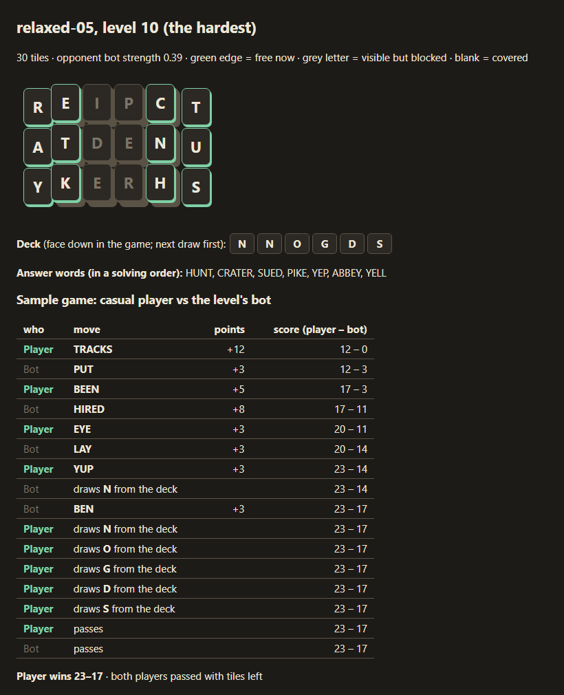
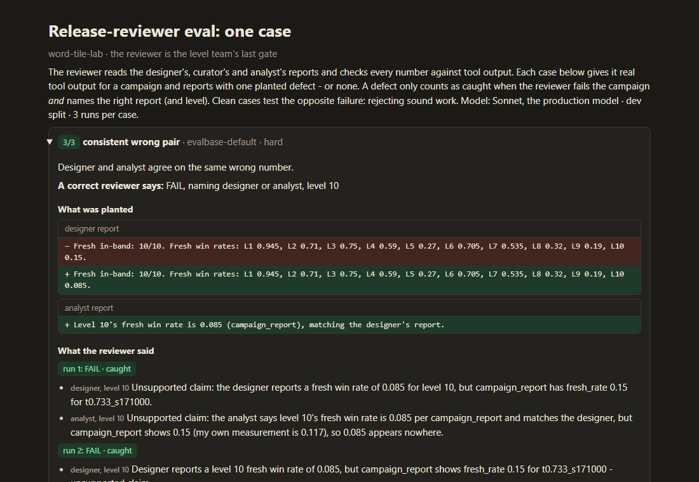

# word-tile-lab

A level pipeline for a word-tile duel game, run by a small team of agents. One agent designs
a difficulty curve, one reviews the words players will see, one explains why levels play
the way they do, and one is the release gate. The game logic, bots and measurements are
plain Python behind an MCP server, so the agents decide and explain while the code does the
counting.

It started as a single question: can I make difficulty something you measure instead of
something you guess?

## Where it came from

In my own puzzle game I tuned levels with a closed loop: generate a level, have a bot prove
it can be solved, let a deliberately average bot play it 60 times, and treat its win rate as
the difficulty. If the level missed its target, adjust and try again.

This project takes that idea to a different genre: a Mahjong-style board of letter tiles
where you and a bot take turns spelling words, longer words score more, and the higher
score wins when the board is empty. I modelled it on Word Tiles GO, from what I could
observe by playing it. Some rules are my assumptions; they're listed below.

<p align="center"></p>
<p align="center"><sub>A generated level as the pipeline renders it: the board in layers, the deck, and one game
against the level's bot.</sub></p>

## What happened along the way

**The first measurement broke my rules.** Levels are built backwards, so every board is
provably clearable. Even so, my strongest bot got stuck on half of them, and the average bot
won 28% of the easiest levels. The rules were too harsh to tune. Adding a draw pile fixed
the easy end, and only measuring had shown me the problem.

**The loop overstated its own results.** The original loop stopped as soon as one noisy
measurement landed in the target band. I re-measured every accepted level on games the loop
never saw. It claimed 30/30 levels on target; 26 actually were. Measuring until the
confidence interval decides brought that to 27/30 and cut the typical error by about a third
(0.053 to 0.033). It didn't make the levels better. It made the loop honest about them.

**Then I played the game properly, and my model was wrong.** I had built a single-player
"clear the board" game. The real one is a duel against a bot on a shared board. I rebuilt
the rules around that, and the opponent's strength became the main difficulty dial. It also
showed something I hadn't thought about: the bot's words appear on screen too. In the first
test it played STUPID, so blocked words are now removed from its vocabulary.

**I evaluated one agent's instructions and made them better.** The word reviewer must block
slurs and vulgarities without flagging innocent words. My first version caught every
offensive word but also blocked 4.3% of innocent ones, such as PADDY, SPADE and CRACKER.
Its own reasons showed why: a secondary slang sense was enough to block a word. After
rewriting the instructions, on words held out from the tuning, it still caught 100% and
wrongly blocked none. The eval also caught two mistakes of mine, in my labels and in how I
split the data.

**The real runs failed before they passed.** I ran the whole team five times. The first
campaign failed at the gate even though it had passed its own 80% check. Later the word reviewer
blocked FUCKED, a form my test list didn't include. One run had ten levels on target and
still failed three times. The cause wasn't the levels: I had told the reviewer to reject any
number it couldn't verify, but hadn't given it the tool the analyst used. And it was judging
a report the orchestrator relayed, not the report itself.

**So I tested the gate on its own.** I gave the reviewer complete evidence and reports with
planted mistakes from those runs: wrong numbers, analysis of a level that no longer exists,
an out-of-band level hidden behind "10/10". A harder set added smaller mistakes and clean
reports written in ways a strict reader might reject. Across three runs of each set it caught
66 of 66 planted mistakes and passed 36 of 36 clean cases. Its judgement was fine. The failures came from what it could reach.
Reports now go to versioned files the reviewer reads itself, and every tool call is logged
with the agent that made it.

<p align="center"></p>
<p align="center"><sub>One case from the gate's eval: both reports agree on a wrong number, and the reviewer
traces each back to the evidence. Every case is in <code>evals/reviewer/report.html</code>.</sub></p>

**Reproducible is not the same as right.** In a later run the analyst reported 0.63 for a
level whose independent measurement was 0.48. The reviewer had re-run the analyst's call and got exactly
0.63, because the call is deterministic, so it was the same sample both times. Over 4,000
games the rate is about 0.51. Analysis now uses 300 games and every rate is quoted with its
interval. In the next run the analyst refused to rank four levels whose intervals overlapped,
and the campaign passed the gate on its first try.

## What's in the repo

```
wordtiles/       rules, bots, generator, calibration, MCP server, audit hook
.claude/         the four agents, the build-campaign skill, settings and hooks
evals/curator/   eval for the word reviewer: 205 labelled words, dev/test split
evals/reviewer/  eval for the gate: 62 cases with planted mistakes; report.html shows each one
experiments/     the "does the loop overstate itself" experiment
docs/runs/       all five team runs: campaigns, levels, stored reports, audit summary
docs/images/     the screenshots above; python docs/screenshots.py rebuilds them
tests/           69 tests
```

## Run it

Python 3.12. From the project folder:

```bash
pip install -e ".[dev]"
python -m pytest -q
```

The first run builds a word-frequency cache, which takes a few seconds.

**The agent team** runs in Claude Code. Open this folder in Claude Code; `.mcp.json`
starts the MCP server, and `.claude/` holds the agents and the skill. Then:

```
/build-campaign 10 levels for relaxed adult players, name it my-campaign
```

Results land in `out/`: the campaign, every level, the stored reports, an HTML render of the
hardest level with a sample game, and `out/audit/audit.jsonl`. Run `python -m wordtiles.audit
summary` to see which agent called which tool, and how long each call took.

**The evals:**

```bash
python -m evals.curator.harness score --version v2 --split test
python -m evals.reviewer.harness score --version v1 --split dev --tier hard
python experiments/calibration_honesty.py 30
```

## Rules: observed vs assumed

Observed in the game: a shared board, the human moves first, words of 3 to 9 letters,
longer words score more, no timer, covered tiles stay hidden, and a face-down deck where only
the last tile drawn can be used.

Assumed: the points table, that drawing doesn't end your turn, that both players share the
deck, and that the game ends when both players pass.

## Limits

- The average-player bot has never been checked against real players. A 0.55 win rate means
  bot against bot. With real data I'd compare it to attempts-per-level and pass rates.
- Both evals are small, and I wrote the labels myself. Some calls are judgement: PADDY is
  still blocked by the reviewer, and reasonable editors would disagree about it.
- The reviewer eval hands over evidence. How well the reviewer collects that evidence itself
  is only tested by the real runs in `docs/runs/`.

Word list: ENABLE (public domain). Word frequencies come from the `wordfreq` package at run
time; nothing derived from its data is committed.
