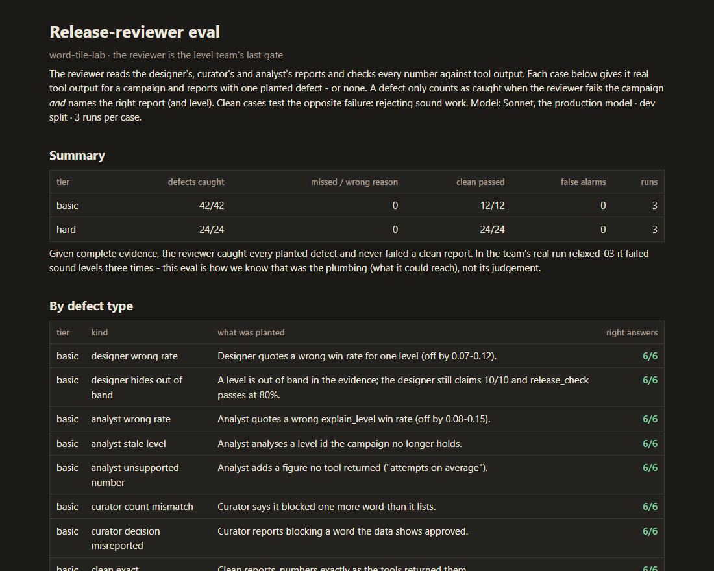

# Eval: the release-reviewer agent

The release reviewer is the team's last gate: it reads the designer's, curator's and
analyst's reports, checks every number against tool output, and answers PASS or FAIL. This
eval asks two questions: does it **catch planted defects** (naming the right report and
level), and does it **pass clean reports** instead of failing them out of strictness?

## Why it exists

In the team's real runs the gate's trouble was never letting a bad campaign through. In
relaxed-03 it failed *sound* levels three times. Was that the reviewer's judgement, or what
it could reach? This eval separates the two by handing it complete evidence.

## The cases

Evidence is real tool output - `release_check`, `campaign_report`, the reviewer's own
`measure_level` runs, `explain_level`, the curator's decision log - from three campaigns:
relaxed-03 (built by the team) and two calibrated for this eval. Reports are generated from
that evidence, then one defect is planted per case. Case ids are opaque and cases are
shuffled, so neither the id nor the order hints at the answer.

**Basic tier** (`cases.json`, 34 cases) - the failure patterns of the team's own runs:

| defect | from |
|---|---|
| wrong number in the designer's / analyst's report | relaxed-01 |
| an out-of-band level hidden behind "10/10" while `release_check` passes at 80% | relaxed-01 |
| analysis of a level the campaign no longer holds | relaxed-01 (stale analysis) |
| a number with no source | relaxed-03 (unverifiable diagnostics) |
| "blocked 5", four listed | relaxed-03 |
| a word reported blocked that the data shows approved | - |
| clean reports, exact and rounded numbers | - |

**Hard tier** (`cases_hard.json`, 28 cases) - built after the basic tier came back perfect:

| defect (must FAIL) | clean (must PASS) |
|---|---|
| a 0.03-0.05 drift (not rounding, easy to skim past) | numbers written as percentages |
| one wrong number in the third paragraph of a four-level report | a long, fully correct report |
| designer and analyst agree on the same wrong number | derived figures (a mean) - not in the evidence, but reproducible |
| a real number attributed to the wrong level | a re-measurement 0.05-0.075 off - inside the 0.08 tolerance, found by trying seeds, not invented |

A defect counts as caught only when the verdict is FAIL **and** a listed problem names the
right report (and level, where there is one).

## Results (Sonnet, the production model; dev split, 3 runs each)

| | defects caught | false alarms on clean |
|---|---|---|
| basic tier, v1 | **42/42** | **0/12** |
| hard tier, v1 | **24/24** | **0/24** |

v1 is the reviewer as it stands after relaxed-03's fixes (reads stored reports itself, has
`explain_level`).

**Used as a regression suite.** relaxed-04 led to two edits in the reviewer's instructions
(`explain_level` now defaults to 300 trials, and a report written before a regeneration must
still match the current campaign). The edited reviewer, v2, was run once per tier:

| | defects caught | false alarms on clean |
|---|---|---|
| basic tier, v2 | **14/14** | **0/4** |
| hard tier, v2 | **8/8** | **0/8** |

No regression. (One run per tier rather than three: v1 showed no run-to-run variation.)

## What this says

- **Given complete evidence, the reviewer's judgement is sound** - it caught every planted
  defect and never failed a clean report, including the formats a strict reader might reject.
- So relaxed-03's three FAILs were **plumbing, not judgement**: the reviewer couldn't reach
  `explain_level`, and judged a report the orchestrator relayed rather than the report
  itself. Both are fixed (`read_report`, the tool in its list), and this eval is why we know
  the fix was aimed at the right layer.
- The eval is saturated: it can't show an improvement, so it serves as a **regression
  suite** - any edit to the reviewer's instructions must keep these scores.

## Limits

- A dry run hands the reviewer its evidence. Whether it *gathers* that evidence well with
  real tool calls is tested only by real team runs, not here.
- The test split was not run: the instructions were never tuned on dev results (there was
  nothing to tune), so dev is effectively held-out; running test would cost ~660k tokens to
  say the same thing.
- Defects are planted one per case; real reports can carry several at once.
- Runs were produced by Claude Code subagents reading the dry-run prompt file;
  `harness.py run` does the same with `claude -p` once the CLI is logged in.

## Read every case



`report.html` shows each dev case: what was planted (a diff against the clean report or
evidence), what a correct reviewer says, and each run's verdict in the reviewer's own words,
with filters for defects / clean cases and tiers. Rebuild it with
`python -m evals.reviewer.report`.

## Reproduce

```bash
python -m evals.reviewer.build_cases                 # basic tier (needs the three campaigns in out/)
python -m evals.reviewer.build_hard                  # hard tier
python -m evals.reviewer.harness prompt --version v1 --split dev --tier hard
python -m evals.reviewer.harness score  --version v1 --split dev --tier hard
```

Cases and saved runs are committed, so scoring works on a fresh clone without rebuilding.
